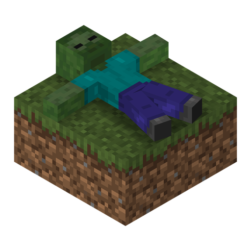

<p align="center"></p>

<h1 align="center">Ragdoll Deaths</h1>

<p align="center">
  
  
  
  
</p>

A small, client-side visual mod. When a mob dies, its body becomes a real physics ragdoll: it is thrown by the killing blow, tumbles over whatever blocks are there, comes to rest, and disappears about 5 seconds later in a puff of smoke where it lay. Nothing changes gameplay.

## Requirements

| | |
|---|---|
| Minecraft | Java Edition **1.21 to 1.21.11** and **26.1 to 26.3** (Forge: every version that has a Forge release) |
| Loader | **Fabric** 0.18.0+, **Quilt** 0.30.1+, **NeoForge** or **Forge** |
| Required mod | **Fabric API** on Fabric and Quilt; nothing on NeoForge or Forge |
| Optional | **Mod Menu** on Fabric and Quilt, for the in-game settings screen |
| Java | 21 for 1.21.x, 25 for 26.x |

## Installation

Pick the jar for your loader and game version, for example `Ragdoll Deaths v1.1.2 - NeoForge 26.2-26.3.jar` or `Ragdoll Deaths v1.1.2 - Fabric 1.21.5-1.21.8.jar`, and put it in your `mods` folder. On Fabric and Quilt, add Fabric API too, and Mod Menu if you want the settings screen. NeoForge and Forge have the settings screen built in, under *Mods → Ragdoll Deaths → Config*.

The mod is **client-only**. Servers don't need it, and every loader skips it on a dedicated server, so no rendering code ever loads server-side. In multiplayer, each player who installs it sees the ragdolls on their own screen.

## Physics bodies (1.1.0)

From 1.1.0 a dead mob is a set of rigid parts joined at its joints, simulated on your client only.

- **Thrown by the blow.** Melee hits knock the body back from the part that was struck; Knockback, sprint hits and Punch throw it further. Arrows hit the part they pass through. Creeper and TNT blasts fling bodies away and are blocked by walls. A mace smash drives the body down.
- **Real contact.** Bodies land on stairs, slabs and fences, slump against walls, pile on each other, slide on ice, bounce on slime, hang in cobwebs and sink into powder snow.
- **Dying muscles.** A body braces and reaches for about a second and a half before going limp.
- **Water and lava.** Bodies float and drift; soul sand bubble columns lift them fast and magma ones slowly. Lava burns black exactly the pixels that touched it.
- **Special mobs.** Skeletons break apart, a snow golem's pumpkin rolls off, blaze and breeze rods drop free, spiders flip and curl.
- **Sounds.** Thuds, splashes and bone clatter, heard only by you.

Turn **Physics Bodies** off in the settings to get the hand-made animations of 1.0 back. The sections below describe those animations; with physics on they are what the dying muscles try to do, not what is drawn.

## What it does

Each death is a short, hand-tuned animation with joints, not a stiff tip-over. The mod reads the model's own named parts (`head`, `right_arm`, `left_hind_leg`, `tentacle3`, …), so the limbs of vanilla mobs, and of most modded mobs, move on their own. Armor and held items follow the limbs they're attached to.

The animation is picked from data the client already receives: the final damage source, the surroundings and the body plan.

**Two-legged mobs** (zombies, skeletons, villagers, illagers, golems, players):

| Death | Animation |
|---|---|
| Hit from the front | Head snaps back and the arms reach up while the body falls backward. One leg kicks. Just after the back hits the ground, the arms splay out and the head rolls aside. |
| Hit from behind | The body arches, then the arms are thrown forward to break the fall. It lands face down with the head turned. |
| Hit from the side | The body twists away from the blow. One arm is flung across the body, the other swings wide, and the legs scissor. |
| No direction (poison, magic, starving) | The knees give out into a kneel, the head droops, then the body folds forward onto its face. |
| Fall damage | The knees buckle on impact and the body slams flat, spread-eagled. |
| Water | Rolls slowly onto its back with arms drifting up and out. |
| Lava | Arms flail overhead as it tips back and sinks. |

**Four-legged mobs** (livestock, horses, donkeys, llamas, camels, wolves, cats, bears, hoglins, sniffers):

Whatever pose the mob died in (a horse rearing from the hit, a sitting wolf or cat, a sleeping fox, a grazing sheep, a sitting camel) is cleared, so it falls from a normal standing pose. The body keeps the heading it died with instead of turning while it falls. Their legs have no knees, so they stay nearly straight; the body does the falling, and it never pitches forward or back, so neither end sinks into the ground. Front and back hits roll the body to a side that varies per mob. Large animals rest on their real torso width, not their wider collision box, so they lie flat on the ground.

| Death | Animation |
|---|---|
| Hit from the side or no direction | Sways away from the blow, the legs give a little, and it rolls over onto its side. Once down, the legs stretch out stiffly with a couple of fading kicks and the head settles to the ground. |
| Hit from the front | Braces its front legs and tosses its head as it staggers back a step, then rolls onto its side. |
| Hit from behind | Kicks its hind legs out and dips its head as it stumbles forward, then rolls onto its side. |
| Fall damage | Belly flop with the legs splayed out sideways. |
| Water | Rolls onto its side, paddling weaker and weaker. |
| Lava | Thrashes while sinking. |

**Other body plans:**

| Mob | Animation |
|---|---|
| Spiders and other angled-leg crawlers | Legs flare, the body flips onto its back, and the legs curl about 70% of the way in with a faint twitch. |
| Bats, phantoms, parrots, chickens | The wings stop flapping, settle to rest and only quiver faintly, and the feet tuck. Flyers keep momentum and spiral down. |
| Bees | A short burst of weakening wing buzz, then the wings droop. |
| Allays, vexes | Fall like bats: the wings go still and the body spirals down and lies where it lands. |
| Blazes | The fire goes out: the circling rods slow to a stop and drop one by one, tipping over flat and rolling out around the body, while the head falls, bounces and rolls over onto one face, away from the blow. |
| Breezes | The whirlwind gives out: it flares once, then unwinds and shrinks into the ground. The head drops and bounces, landing upright and still facing ahead, and the three rods clatter down flat around it. |
| Ghasts and happy ghasts | Drop with gravity, tentacles streaming upward, then splay flat on landing. |
| Fish, squid, dolphins | Fins flop out of water and slow to a stop in it. Squid tentacles curl in. In water they roll belly-up and float. |
| Guardians and elder guardians | In water: convulses with its spikes shot out and its tail lashing, then slowly rolls belly-up as the spikes sink back in and the tail goes still. On land: flops twice, then rolls onto its side. The elder is slower and heavier. |
| Nautiluses | The body pulls back into the shell. In water the shell turns its opening up and floats away; on land it rocks and tips onto its side. A zombie nautilus's rotten body slumps half out of the shell and hangs instead. |
| Slimes and sulfur cubes | The hit stretches the body tall as it leans away, then it slumps into a wide puddle and wobbles like jelly before settling. Splitting is unchanged. |
| Magma cubes | Stiffer: they fold down in three stacked steps, like a collapsing accordion, with a small clack at each step. |
| Shulkers | With Physics Bodies off, the shulker disappears the moment it dies and breaks apart into the same particles, in the same spots and number, as breaking a shulker box of its color (purple for an undyed shulker), with the box's breaking sound. With physics on it tumbles first and breaks when its time is up. |
| Anything else | The head droops, arms hang, and tails, ears and jaws go slack. |

**Special deaths:**

| Mob | Animation |
|---|---|
| Skeletons, strays, wither skeletons, bogged | The legs give out and the skeleton drops onto its pelvis, then comes apart. The skull pops off and rolls away from the hit, the arms and legs clatter flat, and the ribcage lands in the pile. Armor and held items stay with their bones. |
| Snow golem | The snow body melts into a flat patch. The pumpkin keeps its shape, rides down on top, then tips off backward. |
| Warden | Staggers and sinks to its knees, stays kneeling a moment with its head hanging, then slowly tips forward and lies face down with its arms stretched out past its head. Its body stays an extra second. |
| Creeper | The four stubby legs buckle out a little and the tall body sags onto them, then it tips over away from the blow and lies flat with its head rolled aside. A fall does the same, faster. |
| Ravager | Reels from the blow, its legs splay out and it sinks heavily onto its belly, then its jaw falls open. The head keeps its height, and it stays upright on its belly and never rolls over. |
| Armadillo and frog | Flips onto its back with its head, tail and limbs curled up. |

In lava the special mobs use their normal body-plan death.

**Physics.** Bodies move through the world on their own once they die:

- **Real motion.** A thrown, flying or drifting body is moved each tick with gravity and air drag, and collides with blocks the way mobs do. It lands on the real floor, stops against walls and ceilings, bounces on a hard landing and slides to a stop. A mob that dies while falling, or is knocked off a ledge, falls exactly as the game moves its corpse, so it lands where the mob really lands.
- **Bodies don't go through walls.** A body falling over beside a wall comes to rest slumped against it instead of swinging into it.
- **Limbs with weight.** Every arm, leg, head, tail, ear and wing is a damped spring around the animation's pose, pushed by real forces. Limbs lag behind when the body starts to fall, keep swinging when it stops short on the ground, are flung toward the killing blow, float during a fall and are slammed down by a hard landing. They sag under gravity as the muscles go limp. Every swinging limb collides with the world: it stops against the ground or a wall instead of going into it, and an arm the animation would fling into a wall folds back down along the body.

**Explosions.** A mob killed by a creeper, TNT, a bed in the Nether or any other explosion is thrown far through the air, away from the blast. It plays its normal death on the way, the one for a hit from that direction, with its limbs trailing. Then it lands with a bounce and slides to a stop. Every explosion death throws the body: about 35 blocks right at the blast, about 10 at the edge of its reach. Heavy mobs like the iron golem and ravager fly less far, and a mob whose Blast Protection absorbs the push dies normally in place. Walls and ceilings stop the body, and a body thrown off a ledge lands on the floor below.

**Riders.** A rider that dies on a mob it's riding is thrown off instead of dying in the saddle. This covers skeleton horsemen, spider and chicken jockeys, illagers on a ravager, and a player on a horse or camel. The rider is pushed away from the blow, carried along by its mount's momentum, and plays its fall-impact death once it hits the ground. Riders in boats and minecarts, or over water or lava, keep the vanilla death.

**Uneven ground.** Bodies lie along the ground they fall on. A body that topples against stairs, a slab or a hillside rests tilted up on it instead of sinking in, and one that falls over a step drapes down over the edge (by at most 40° up and 30° down). The ground is measured once, where the body comes to rest.

**Deaths in mid-air.** Any mob that dies more than about 1.5 blocks above the ground (knocked off a ledge, shot while jumping from a height) keeps falling under gravity with its limbs trailing upward. This includes a mob that dies standing on a ledge and is knocked off by the killing blow. Its death animation, the fall-impact version, only starts once the body actually lands, wherever that is: on blocks placed or broken during the fall, or on the ground far below after drifting past a ledge. A body still in the air when vanilla removes the mob keeps falling and stays until it lands, for up to 10 seconds. Only over the void, with no floor within 96 blocks below, does it disappear in the air, after 3 seconds (`ghostMaxTicks`). Flying mobs, from bats and phantoms to ghasts, fall the same way. A body that falls into water floats and rolls over instead of slamming flat; one that falls into lava sinks.

**Deaths in water.** A body that floats up (or sinks, with `waterBehavior` set to `SINK`) speeds up as it goes and stays until it reaches the surface or the bottom, plus half a second. If it hasn't got there after 3 seconds (`ghostMaxTicks`), it disappears where it is. **Flowing water carries the body** along with the current, around corners and against the banks, until it vanishes. This goes for mobs that die in water and for bodies that fall or are thrown into it; how long the body stays doesn't change.

Heavy mobs move slower and with less overshoot. Babies are a little quicker. While the ragdoll is shown, the red death tint is hidden; normal hits still flash red exactly as in vanilla. Vanilla's death poof is moved: instead of puffing where the mob stood when vanilla removes it, the body puffs where it actually lay when it disappears, with vanilla's death smoke plus a few silverfish (infested) specks. Shulkers only break into their shulker box particles.

### Kept vanilla on purpose

These keep the plain vanilla death: the **Ender Dragon** and **Wither** (scripted boss deaths), **armor stands** and **mannequins** (they break rather than die), the **Creaking**, and anything that dies while riding a **boat** or **minecart**.

**Players** get ragdolls by default; turn `playerRagdolls` off to give them the vanilla death.

## Configuration

On NeoForge and Forge, or on Fabric and Quilt with **Mod Menu** installed, open *Mods → Ragdoll Deaths → Config* for a settings screen with tooltips and a *Reset to Defaults* button. Changes apply as soon as you press *Done*. Otherwise, edit `config/ragdolldeaths.json`; it's re-read every time you join a world. Invalid values are clamped, and if the file is unreadable the mod logs a warning and uses the defaults.

**General**

| Key | Default | Meaning |
|---|---|---|
| `enabled` | `true` | Turns the death animations on or off. When off, every mob and player dies with the normal Minecraft animation. |
| `playerRagdolls` | `true` | Animate players, yourself included in third person. |
| `lifetimeTicks` | `30` | How long a body stays (4–60 ticks). Past vanilla's 20 ticks the body is drawn client-side after the server removes the mob. |
| `animationSpeed` | `1.0` | Plays every death faster or slower (0.5–2). |
| `maxRenderDistance` | `64.0` | Deaths farther from the camera use the vanilla death. |
| `maxActiveRagdolls` | `64` | Cap on bodies animating at once. |
| `hideDeathTint` | `true` | Hide the red tint on dying bodies. |

**Motion**

| Key | Default | Meaning |
|---|---|---|
| `hitReactionStrength` | `1.0` | Push from the killing blow (0–2). At `1.0` the body moves about 0.35 blocks. |
| `bounceStrength` | `1.0` | Bounce and settle on landing (0–2). |
| `limbAnimation` | `true` | Animate heads, arms, legs, wings and tails. Off moves the whole body only. |
| `legKicks` | `true` | Fading kicks, twitches and paddling after landing. |

**Environment**

| Key | Default | Meaning |
|---|---|---|
| `waterBehavior` | `FLOAT` | `FLOAT`, `SINK` or `NEUTRAL`, for land mobs dying in water. A floating or sinking body speeds up as it goes and stays until it reaches the surface or the bottom, up to `ghostMaxTicks`. Water mobs always float. |
| `lavaSink` | `true` | Sink into lava. |
| `fallImpact` | `true` | Slam flat on fall-damage deaths. |
| `throwRiders` | `true` | Throw a rider that dies on a mob it's riding off its mount. Off, riders keep the vanilla death. |

**File only.** `wardenExtraTicks` (default `20`, 0–60) is the Warden's extra time, and `ghostMaxTicks` (default `60`, 20–100) is the longest a body may keep falling over the void (with a floor below, it falls until it lands), or floating up to the surface or sinking to the bottom in water. These two aren't on the settings screen.

**Lists**

| Key | Default | Meaning |
|---|---|---|
| `excludedEntities` | `[]` | Entity ids that always keep the vanilla death, e.g. `"mod_name:mob_name"`. A bare name means `minecraft:`. |

### Physics settings

| Setting | Default | What it does |
|---|---|---|
| Physics Bodies | On | Real physics bodies. Off brings back the 1.0 animations. |
| Knees and Elbows (Beta) | Off | Cuts arms and legs in two so they bend. |
| Physics Body Lifetime | 5 s | How long a body stays. |
| Physics Quality | Medium | Low is lighter and bodies stop piling on each other; High is steadier in piles. |
| Max Physics Bodies | 48 | The oldest vanishes when another is needed. |
| Explosion Throw | 100% | How hard explosions throw bodies. |
| Dying Muscles | 1.5 s | How long a body braces before going limp. |
| Fall Reflexes | On | Arms out in a forward fall, chin tucked in a backward one. |
| Skeletons Break Apart | On | Off, skeletons fall in one piece. |
| Impact Sounds | On | Thuds, splashes, bone clatter. |
| Impact Dust | On | Block dust on hard landings, drops on splashes. |
| Death Camera | Off | While you are dead, the view follows your body's head and slowly circles it. |
| Death Camera Distance | 3.5 blocks | How far the death camera stays from your body. |
| Death Camera Circling | On | Whether the death camera circles your body or holds its angle. |
| Player Body Until Respawn | On | A player's body stays until they respawn, instead of going after the body lifetime. |

## Compatibility philosophy

- **Visual only.** Deaths, drops, XP, sounds, advancements, scoreboards, game rules and AI are untouched. Nothing is sent over the network, and no entities are created or replaced. The body that lingers after vanilla removal is only drawn on your client.
- **Light physics.** There's no physics engine. Each body takes one small step per tick, not per frame: one collision sweep for a moving body (the same one vanilla moves mobs with), a spring per limb, and a few block lookups to keep the body and its limbs out of walls. Drawing blends between the last two steps.
- **Narrow hooks.** A few small mixins:
  - after an entity's render state is built,
  - one transform after the living renderer's first `pushPose`,
  - after a model's own `setupAnim`, to rotate joints only for a body that is mid-death,
  - replacing vanilla's 90° death-flip angle only while a ragdoll is active,
  - skipping the vanilla death poof, only for bodies this mod is animating (the mod spawns its own where the body lay),
  - culling a body that's being animated by where it's drawn, not by its hitbox.
- **Entity Model Features.** With EMF installed (the mod behind Fresh Animations, AL's packs and other "3D mobs" packs), a body keeps its pack's look: EMF's animations pause on a mob while it is a ragdoll, and the limbs are shaped from the vanilla parts EMF keeps behind the pack's model. EMF is optional and never required.
- **Graceful fallback.** Mobs whose renderer isn't a standard living renderer (for example GeckoLib models) simply keep the vanilla death. If a renderer throws, ragdolls are turned off for that one entity type for the session, with a single log line, and vanilla takes over.

## Limitations

- Joints are recognised by part names. Modded models with unusual names fall back to a whole-body animation with a limp head.
- Collision is checked along the body's length and at each limb's middle and end, not over every cube, so a corner of a model can still touch a block.
- Collision is approximate. The body is kept out of walls using checks made at the moment of death, and a body resting on the ground doesn't notice blocks that change under it afterward.
- A ragdoll is only built if the mob was rendered while dying. Deaths you can't see stay vanilla.
- Modded mobs with fully custom renderers keep vanilla deaths. Add `excludedEntities` entries for any mob that looks wrong.
- Edits to the config file apply on the next world join; the settings screen applies them immediately.

## Troubleshooting

- **A mod's mob looks wrong:** add its id to `excludedEntities`.
- **"Disabling ragdolls for … after an error" in the log:** that mob's renderer couldn't handle the transform. It now uses the vanilla death for the rest of the session. Please report it with the log.
- **Nothing happens:** check that Fabric API is installed (Fabric and Quilt), `enabled` is `true`, and the mob isn't farther away than `maxRenderDistance`.
- **Want the vanilla death for one mob:** add its id to *Always Vanilla Death* (`excludedEntities`).

## Building from source

```bash
./build-all.sh
```

This builds every jar, one per loader and game-version group, into `Desktop/Ragdoll Deaths/Builds/<Loader>/<mod version>/`. `./gradlew build` alone makes the Fabric jar for 26.2–26.3 in `build/libs/`, `./gradlew test` runs the unit tests, and `./gradlew runClient` starts a development client. `./gradlew -p legacy runClient -Pminecraft_version=… -Pcompat=…` does the same for 1.21.x (see `build-all.sh` for the values). `./selftest-all.sh all` checks every jar group in a real world (see TESTING.md).

How the sources are split:

- `src/main`: everything that doesn't depend on the loader or the game version.
- `src/mc1_21_0`, `src/mc1_21_2`, `src/mc1_21_5`, `src/mc1_21_9`, `src/mc1_21_11`, `src/mc26_1`, `src/mc26_2`: what differs between game versions: `Compat` (calls that moved), `Mobs` (mob classes that moved), `VanillaPoses`, and the mixins whose targets changed. 1.21.2 to 1.21.8 draw a mob straight away instead of submitting it, so their render mixins are different hooks altogether. 1.21 and 1.21.1 have no render states at all: `src/mc1_21_0` carries stand-ins of its own (in `net/minecraft/client/renderer/entity/state`, used only by the mod), filled by `RagdollStates` just before a dying mob is drawn, and `ModelRoots` finds the root part most of its models do not keep.
- `src/fabric`, `src/quilt`, `src/neoforge`, `src/forge`: each loader's entrypoint and metadata. `src/forge_bus6`, `src/forge_bus7class` and `src/forge_bus7` are Forge's client half for its old event bus (before 1.21.6), the new one (1.21.6 to 1.21.8) and the new one with record events (1.21.9 and later); before 1.21.10 the Forge jar also carries MixinExtras (`-Pbundle_mixinextras`). `src/forgelike_*` holds the ghost-body mixin that NeoForge and Forge use in place of Fabric API's extraction event, and for 1.21 an access transformer.
- The root Gradle build makes the Fabric and Quilt jars for 26.x; `legacy/` makes them for 1.21.x, whose game files are obfuscated and mapped while building; `neoforge/` and `forge/` are separate Gradle builds over the same sources, for every game version (`-Pjava_version=21` for 1.21.x).
